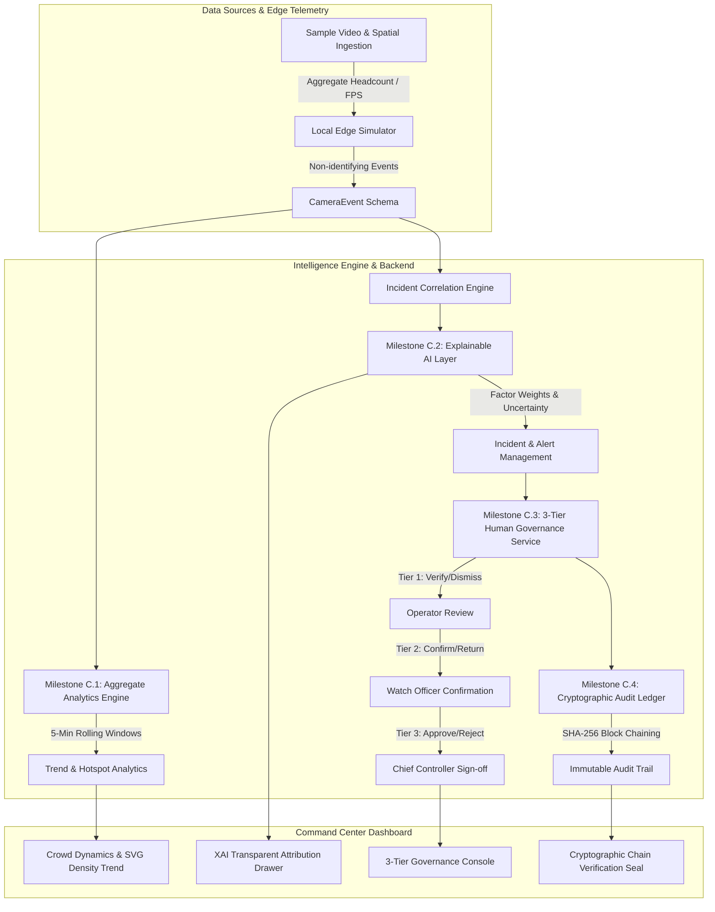

# OPERATION PRAHAAR AI — FINAL SYSTEM ARCHITECTURE SPECIFICATION
## Advanced AI-Powered Public Safety & Counter-Terrorism Decision Support Platform

**Platform Tagline:** *"Justice Through Intelligence. Protection Through Technology."*  
**Classification:** Independent Educational Prototype & Responsible AI Decision Support System  
**Deployment Target:** Local Windows Environment (< 300 MB RAM, ₹0 Cloud Budget)  
**Security & Privacy Baseline:** Zero Facial Recognition; Zero Individual Tracking; Strict Human-in-the-Loop Authority.

---

### 1. Architectural Philosophy & Non-Negotiable Invariants

Operation Prahaar AI was engineered to address critical national safety challenges at mass transit terminals and sensitive gathering venues while upholding the highest standards of Responsible AI:

1. **No Facial Recognition or Individual Profiling:**  
   The platform processes strictly non-identifying aggregate occupancy counts, flow rates, and spatial geometry. No face embeddings, watchlists, or demographic inferences exist anywhere in the code or database schema.
2. **Mandatory Human Verification (HITL):**  
   Every AI alert begins in the `UNVERIFIED` state. Autonomous police dispatch, weapon systems, and drone controls are strictly prohibited. Decisions progress through a 3-tier sequential human authorization gate.
3. **Deterministic & Reproducible Explainable AI (XAI):**  
   No black-box alerts. Every safety assessment produces a transparent factor weight breakdown, identifying exact input values, baseline thresholds, uncertainty quantification, and an evaluation hash.
4. **Append-Only Cryptographic Audit Ledger:**  
   Every operator review, supervisory confirmation, and state change is linked to its predecessor via SHA-256 block hashing anchored to a 64-zero genesis block. Any database tampering or log deletion is instantly detected.

---

### 2. High-Level System Architecture Diagram

---

### 3. Detailed Component Breakdown

#### A. Aggregate Analytics Engine (Milestone C.1)
- **Monitored Demonstration Zones:**
  - `ZONE-A: Main Concourse` (Capacity: 500 occupants)
  - `ZONE-B: Entry Hall` (Capacity: 300 occupants)
  - `ZONE-C: Waiting Area` (Capacity: 400 occupants)
  - `ZONE-D: Exit Corridor` (Capacity: 250 occupants)
- **Mathematical Processing:**
  - 5-minute rolling time window bucketing.
  - Zero-division safety wrappers (`_safe_div`) preventing NaN errors.
  - Directional trend classification (`STABLE`, `RISING`, `FALLING`).
  - Hotspot risk ranking based on relative occupancy ratios.
- **REST Endpoints:**
  - `GET /api/v1/analytics/trends?zone={zone_id}`
  - `GET /api/v1/analytics/hotspots`
  - `GET /api/v1/analytics/summary`

#### B. Explainable AI (XAI) Advisory Layer (Milestone C.2)
- **Heuristic Evaluation Trees:**
  - `DEMO_OCCUPANCY_THRESHOLD_RULE`: Triggered when headcount exceeds 75% capacity envelope.
  - `DEMO_CONGESTION_FLOW_RULE`: Evaluates pedestrian velocity deceleration ($< 1.0\text{ m/s}$).
  - `DEMO_EDGE_HEALTH_RULE`: Monitors frame rate consistency ($\ge 4\text{ FPS}$) and hardware latency.
  - `DEMO_CONNECTIVITY_HEALTH_RULE`: Flags intermittent network drops.
- **Transparent Attribution:**
  - Measures input telemetry vs. safety baselines.
  - Assigns explicit percentage weights summing to 100%.
  - Generates reproducible evaluation hash: `SHA-256(rule_id | confidence | factors)`.
- **REST Endpoint:**
  - `GET /api/v1/incidents/{incident_id}/explainability`

#### C. Multi-Tier Human Verification (Milestone C.3)
- **Tier 1 — Control Room Operator Review:**
  - Roles: `COMMAND_OPERATOR`, `CHIEF_CONTROLLER`
  - Decisions: `VERIFIED` or `DISMISSED`
  - Enforces minimum 15 characters operational rationale.
- **Tier 2 — Senior Watch Officer Tactical Review:**
  - Roles: `INTELLIGENCE_ANALYST`, `COMMAND_OPERATOR`, `CHIEF_CONTROLLER`
  - Decisions: `CONFIRMED` (advances to `TACTICAL_CONFIRMED`) or `RETURNED` (reverts to `NEW`)
  - Enforces minimum 15 characters supervisory rationale.
- **Tier 3 — Chief Controller Executive Sign-Off:**
  - Role: `CHIEF_CONTROLLER` strictly.
  - Decisions: `APPROVED` (`ADVISORY_PUBLISHED`) or `REJECTED` (`ADVISORY_REJECTED`)
  - Enforces minimum 15 characters controller comments.
- **REST Endpoints:**
  - `POST /api/v1/governance/tier1`
  - `POST /api/v1/governance/tier2`
  - `POST /api/v1/governance/tier3`
  - `GET /api/v1/governance/queue`

#### D. Cryptographic Audit Ledger (Milestone C.4)
- **Block Chaining:**
  - Canonical digest: `SHA-256(id | timestamp | actor_id | event_type | record_ref | action_summary | previous_hash)`
  - Predecessor linkage: Block $N$ stores `previous_hash = Block N-1 current_hash`.
  - Genesis anchor: Block 0 links to $64 \times \text{'0'}$.
- **Tamper Verification:**
  - Traverses ledger chronologically from genesis to chain head.
  - Detects content mutation, unauthorized edits, and broken links from deleted rows.
- **REST Endpoints:**
  - `POST /api/v1/audit-logs/verify-chain`
  - `GET /api/v1/audit-logs/verify-chain`
  - `POST /api/v1/audit-logs/backfill-chain`

---

### 4. Database Schema Specification

All 14 entities are persisted in local SQLite with SQLAlchemy ORM:

| Table | Primary Role | Cryptographic / Safety Guardrails |
| :--- | :--- | :--- |
| `organizations` | Safety agency metadata | Single-tenant isolation |
| `roles` | RBAC role definitions | `COMMAND_OPERATOR`, `INTELLIGENCE_ANALYST`, `CHIEF_CONTROLLER` |
| `users` | Security operator registry | Badge numbers, active flags, password hashes |
| `locations` | Physical transit sites | Coordinate bounds, sensitivity ratings |
| `edge_devices` | Edge compute nodes | Telemetry heartbeats, RAM/CPU budgets |
| `cameras` | Video capture devices | RTSP/file streams, resolution, status |
| `camera_events` | Spatial telemetry events | Headcounts, motion energy, zero facial data |
| `incidents` | Correlated security events | Explainability rule, uncertainty score, multi-tier state |
| `alerts` | Actionable UI notifications | Strictly default to `UNVERIFIED` |
| `security_advisories` | Official threat bulletins | Issuing agencies, threat levels, time bounds |
| `human_reviews` | Tier 1 inspection records | Reviewer badge, mandatory rationale |
| `approvals` | Tier 2 & 3 sign-offs | Watch Officer & Chief Controller decisions |
| `evidence` | Non-identifying artifacts | Spatial snapshots, sensor logs |
| `audit_logs` | Append-only ledger | `previous_hash`, `current_hash`, `record_reference` |

---

### 5. Verification & Testing Matrix

The prototype passes 56/56 automated tests:
1. `test_phase1_foundation.py`: 4 tests (Invariants, directory structure, config)
2. `test_phase2_backend.py`: 7 tests (Database schema, APIs, review workflows)
3. `test_phase3_frontend.py`: 4 tests (Component files, build bundle, type definitions)
4. `test_phase_b_demo_controller.py`: 16 tests (5 scenarios, bounds, auth, atomic rollback)
5. `test_phase_c_analytics.py`: 7 tests (Zones, rolling 5-min windows, safe division)
6. `test_phase_c_xai.py`: 4 tests (Attribution factors, rules, 100% reproducibility)
7. `test_phase_c_governance.py`: 8 tests (3-tier state machine, role permissions, min rationale)
8. `test_phase_c_audit_chain.py`: 6 tests (Genesis anchor, linkage, SQL tamper detection)

**Total Execution Time:** Under 2 seconds.
