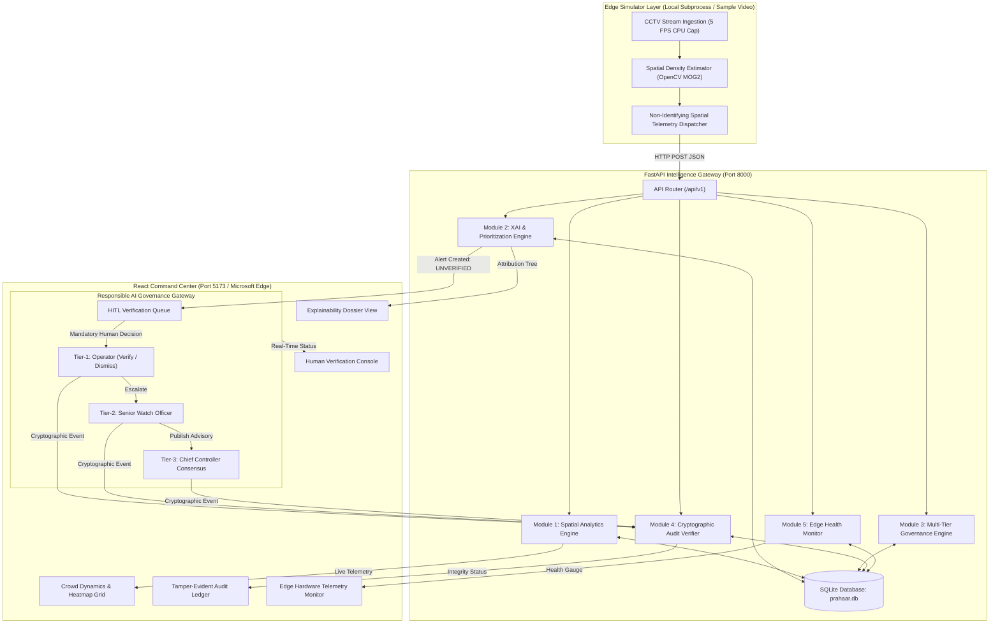
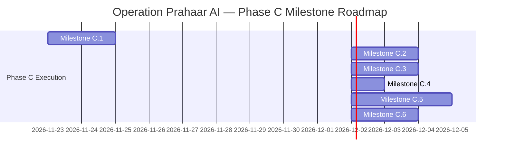

# OPERATION PRAHAAR AI — PHASE C TECHNICAL ARCHITECTURE PLAN
### Comprehensive Blueprint: Explainable Decision Support, Multi-Tier Governance & Aggregate Spatial Analytics
**Project:** Operation Prahaar AI (Student-Built Synthetic Public-Safety Decision-Support Prototype)  
**Author:** Software Architecture & Security Engineering Team  
**Status:** DRAFT PROPOSAL FOR USER REVIEW & APPROVAL (PLANNING ONLY — DO NOT IMPLEMENT)  
**Baseline Commit:** `beb5c77279cefa9fd2f687d0e30c8764c49f8a74` (`phase-b-final-verified`)  

---

## 1. Phase C Objectives

Operation Prahaar AI was initiated to demonstrate that a modern, responsible, ethical AI public safety decision-support system can be designed and executed on a **zero-rupee budget** on a standard student laptop (8 GB RAM), strictly without invasive facial recognition or autonomous physical enforcement.

With **Phase A** (Command Center UI Redesign) and **Phase B** (Synthetic Demo Controller, Badged Authentication, and End-to-End Verification) complete and frozen, **Phase C** represents the operational decision-support maturation of the platform:

1. **Explainable AI (XAI) Advisory Layer:** Provide human operators with clear, transparent heuristic breakdowns, confidence metrics, and uncertainty ratings for every system alert.
2. **Multi-Tier Human Governance & Escalation:** Formalize multi-operator workflows where critical public safety advisories require consensus approval between Command Operators and Chief Controllers before advisory publication.
3. **Aggregate Spatial Analytics Engine:** Synthesize non-identifying spatial crowd density, optical flow velocity, and transit bottleneck trends across time-series windows without tracking individuals.
4. **Cryptographic Audit Ledger Verification:** Upgrade the append-only audit trail to include cryptographic hash verification, proving tamper-evidence for post-incident oversight.
5. **Lightweight Operational Footprint:** Retain a sub-300 MB combined RAM footprint across FastAPI, SQLite, and the React Command Center, allowing frictionless local student evaluation.

---

## 2. Proposed Architectural Modules

Phase C introduces five cohesive, decoupled backend and frontend service modules:

```
+---------------------------------------------------------------------------------------------------+
|                                  PRAHAAR PHASE C ARCHITECTURE MODULES                             |
+---------------------------------------------------------------------------------------------------+

  [ MODULE 1: SPATIAL ANALYTICS SERVICE ] (backend/app/services/analytics.py)
  - Time-series sliding window aggregation (1m, 5m, 15m density ratios)
  - Transit concourse bottleneck velocity index
  - Zone saturation & aggregate footfall heatmaps (purely non-identifying matrix math)

  [ MODULE 2: EXPLAINABLE AI & PRIORITIZATION ] (backend/app/services/xai.py)
  - Heuristic attribution trees (e.g., Density Threshold + Flow Deceleration + Surge Trend)
  - Transparent severity ranking (CRITICAL, HIGH, MEDIUM, LOW) based on explainable factors
  - Uncertainty quantification (LOW, MODERATE, HIGH) based on edge frame latency & sensor confidence

  [ MODULE 3: MULTI-TIER HITL GOVERNANCE ] (backend/app/services/governance.py)
  - Tier-1: Control Room Operator Verification (Single-click review with mandatory rationale)
  - Tier-2: Senior Watch Officer Tactical Escalation
  - Tier-3: Chief Controller Public Safety Advisory Release Sign-Off (Multi-role consensus)

  [ MODULE 4: AUDIT INTEGRITY & ACCOUNTABILITY ] (backend/app/services/audit_verifier.py)
  - SHA-256 chained hash ledger validation (detects retroactive database mutations)
  - Tamper-evident ledger export for judicial/oversight review
  - Comprehensive actor badge attribution

  [ MODULE 5: SYSTEM HEALTH & TELEMETRY GAUGES ] (backend/app/services/health_monitor.py)
  - Edge appliance heartbeat tracking (sliding 60-second window)
  - Autonomous downscaling alert generation when edge processing latency spikes > 200ms
  - SQLite connection pool & memory telemetry reporter
```

---

## 3. Phase C Architecture Diagram



---

## 4. Backend and Frontend Changes Required

### Backend Changes
1. **Analytics Endpoints (`backend/app/api/endpoints/analytics.py`):**
   - `GET /api/v1/analytics/crowd-trends`: Returns 15-minute rolling average density ratios and optical flow velocity.
   - `GET /api/v1/analytics/hotspots`: Returns camera locations ranked by congestion frequency.
   - `GET /api/v1/analytics/summary`: High-level aggregate KPIs for dashboard summary cards.
2. **Explainability Endpoint (`backend/app/api/endpoints/incidents.py`):**
   - `GET /api/v1/incidents/{incident_id}/explanation`: Returns the structured feature attribution tree, triggered heuristic parameters, sensor uncertainty factors, and mitigating context.
3. **Multi-Tier Approval Endpoints (`backend/app/api/endpoints/approvals.py`):**
   - `POST /api/v1/approvals/request`: Initiates an escalation sign-off request.
   - `POST /api/v1/approvals/{approval_id}/decide`: Submits executive sign-off (`APPROVED` or `REJECTED`) with cryptographic signature.
   - `GET /api/v1/approvals/pending`: Retrieves pending approvals filtered by operator tier.
4. **Audit Verification Endpoint (`backend/app/api/endpoints/audit.py`):**
   - `POST /api/v1/audit-logs/verify-chain`: Traverses the audit log database, recalculates SHA-256 state signatures, and asserts ledger integrity.

### Frontend Changes
1. **Crowd Dynamics View (`frontend/src/views/CrowdAnalytics.tsx`):**
   - Integrate zero-dependency SVG time-series charts showing crowd density thresholds (75% warning, 85% critical).
   - Display transit terminal zone status cards (Concourse South, Platform 1 Ingress, Footbridge East).
2. **Explainability Dossier (`frontend/src/views/SecurityIntelligence.tsx`):**
   - Display explainability cards with visual confidence meters (e.g., 92% confidence, Low Uncertainty, Flow Deceleration 40%).
   - Explicitly cite the mathematical rule triggered (`DEMO_OCCUPANCY_THRESHOLD_RULE`, `DEMO_CONGESTION_FLOW_RULE`).
3. **Multi-Tier Verification Console (`frontend/src/views/HumanVerification.tsx`):**
   - Add multi-tier workflow controls: Tier 1 (Initial Operator Review), Tier 2 (Watch Officer Escalation), Tier 3 (Advisory Release).
   - Require mandatory rationale text (minimum 15 characters).
4. **Audit Ledger Verification Panel (`frontend/src/views/AuditLogs.tsx`):**
   - Add a one-click "VERIFY LEDGER INTEGRITY" button in the UI that displays a green cryptographic integrity seal (`SHA-256 CHAIN INTACT • 0 MUTATIONS`).
5. **Operator Badge Switcher in Header (`frontend/src/components/Header.tsx`):**
   - Add a prototype role selector dropdown (switch between `IND-OPR-4081` [Operator], `IND-ANA-2094` [Analyst], and `IND-ADM-001` [Chief Controller]) to facilitate demonstration of RBAC permission enforcement.

---

## 5. Database Schema Evolution Plan (Phase C Migrations)

> [!NOTE]
> Database changes below are planned designs. No database modifications or schema migrations will be executed until Phase C development is formally approved.

### 1. New Explicit Entity Marker (`is_synthetic`)
Add an indexed boolean column to ensure synthetic test events can never be confused with operational records:
- `incidents.is_synthetic`: `Boolean(default=True, nullable=False, index=True)`
- `alerts.is_synthetic`: `Boolean(default=True, nullable=False, index=True)`
- `camera_events.is_synthetic`: `Boolean(default=True, nullable=False, index=True)`

### 2. Multi-Tier Approval Evolution (`approvals` table)
Enhance the existing `approvals` table with governance fields:
- `tier_level`: `Integer(default=1, nullable=False)` (1 = Watch Officer, 2 = Chief Controller)
- `rationale`: `Text(nullable=False)`
- `digital_signature`: `String(64)(nullable=False)` (SHA-256 of approver ID + timestamp + decision)
- `expires_at`: `DateTime(nullable=True)`

### 3. Aggregate Spatial Telemetry Table (`spatial_aggregates`)
For storing 5-minute rolling window spatial metrics:
```sql
CREATE TABLE spatial_aggregates (
    id VARCHAR(36) PRIMARY KEY,
    camera_id VARCHAR(36) REFERENCES cameras(id),
    window_start DATETIME NOT NULL,
    window_end DATETIME NOT NULL,
    avg_density_ratio FLOAT NOT NULL,
    peak_density_ratio FLOAT NOT NULL,
    flow_velocity_avg FLOAT NOT NULL,
    sample_frame_count INTEGER NOT NULL,
    anomaly_flag BOOLEAN DEFAULT FALSE,
    created_at DATETIME NOT NULL
);
CREATE INDEX idx_spatial_agg_camera_window ON spatial_aggregates(camera_id, window_start);
```

---

## 6. API Design Proposal

```
+--------------------------------------+----------------------------------------------------+--------------------------+
| Endpoint                             | Method & Payload                                   | Response Schema          |
+--------------------------------------+----------------------------------------------------+--------------------------+
| /api/v1/analytics/trends             | GET (params: window='1h', camera_id=None)          | List[CrowdTrendPoint]    |
| /api/v1/analytics/hotspots           | GET (params: limit=5)                              | List[HotspotSummary]     |
| /api/v1/incidents/{id}/explainability| GET                                                | IncidentXAIRead          |
| /api/v1/approvals/request            | POST { incident_id, tier, requested_by, note }     | ApprovalRead (PENDING)   |
| /api/v1/approvals/{id}/decide        | POST { action: "APPROVED"|"REJECTED", comments }   | ApprovalRead (RESOLVED)  |
| /api/v1/audit-logs/verify-chain      | POST { start_time, end_time }                      | AuditIntegrityReport     |
| /api/v1/health/edge-telemetry        | GET                                                | EdgeTelemetryOverview    |
+--------------------------------------+----------------------------------------------------+--------------------------+
```

---

## 7. Security and Privacy Considerations

1. **Strictly Development-Only Badge Authentication:**
   - Clearly label all prototype authentication headers as local evaluation credentials.
   - For public demonstrations, implement session timeouts and prevent credential caching.
2. **Ephemeral Frame Handling Guarantee:**
   - Vision frame buffers must strictly exist in volatile Python memory during MOG2 background subtraction and be discarded immediately upon metric calculation.
   - Disk writes for frame images are prohibited; only anonymized JSON spatial metrics are persisted.
3. **Zero Biometric Feature Storage:**
   - Schema and code audits must verify that no vector embeddings, face crops, landmark points, or personally identifiable attributes exist anywhere in SQLite.
4. **Data Minimization:**
   - Data stored for spatial analytics contains only timestamps, zone identifiers, estimated density ratios (0.00–1.00), and motion vectors.

---

## 8. Responsible AI Safeguards

| Principle | Technical Enforcement Mechanism |
|---|---|
| **No Facial Recognition** | Vision pipeline uses background motion subtraction (OpenCV MOG2) and bounding box contour area calculation only. No face detection models (Haar cascades, MTCNN, YOLO-Face) imported or installed. |
| **No Real-Person Tracking** | Object centroids are tracked strictly within a single camera's frame for short 5-second intervals to compute flow velocity. Zero cross-camera re-identification (ReID) or feature embedding storage. |
| **No Autonomous Action** | All generated alerts are created with `review_status = "UNVERIFIED"`. The system contains zero automated dispatch, API webhooks to law enforcement, or siren/gate controls. |
| **Mandatory Human Agency** | Status transitions to `VERIFIED` or `ESCALATED` strictly require an authenticated human user submitting a verified operator badge with a rationale string ($\ge 15$ characters). |
| **Visual Synthetic Watermarking** | Every generated demonstration incident and alert is prefixed with `[SYNTHETIC DEMO]` in all UI tables, cards, and modal dialogs to prevent confusion during evaluations. |

---

## 9. Testing Strategy

1. **Isolated SQLite Test Harness:**
   - Maintain the practice established in Phase B: all unit and integration tests run against isolated, dynamically created temporary databases (`test_isolated_<uuid>.db`) and clean up in `tearDownClass`. Zero tests execute against `prahaar.db`.
2. **Automated Microsoft Edge UI Smoke Tests:**
   - Extend `edge_e2e_verifier.py` to drive all new Phase C views (Spatial Analytics charts, XAI explanation dialogs, Multi-tier approval buttons).
3. **Cryptographic Tamper-Detection Efficacy Test:**
   - Implement a test that deliberately mutates an audit row via direct SQL and asserts that `POST /api/v1/audit-logs/verify-chain` flags the integrity violation.
4. **Performance & Memory Profiling:**
   - Verify that running simulated 5 FPS spatial analysis across 3 virtual cameras consumes $< 300\text{ MB}$ RAM on the host laptop.

---

## 10. Development Milestones & Sequence



### Milestone Details:
- **Milestone C.1 — Aggregate Spatial Analytics Service:** Time-series density aggregation, bottleneck velocity calculations, non-identifying spatial statistics.
- **Milestone C.2 — Explainable AI (XAI) Attribution Engine:** Feature contribution breakdowns, heuristic transparent scoring, explainable alert summaries.
- **Milestone C.3 — Multi-Tier HITL Governance & Escalation:** Tier-1, Tier-2, and Tier-3 role sign-offs with consensus gating and digital signatures.
- **Milestone C.4 — Cryptographic Audit Trail Verifier:** Chained hash validation, integrity reporting, tamper alert generation.
- **Milestone C.5 — Command Center Frontend Visualization:** Responsive SVG time-series charts, explainability dossier modal, multi-tier review console.
- **Milestone C.6 — Full Regression Suite & Verification:** 45+ backend automated tests, Edge CDP browser test suite, final sign-off documentation.

---

## 11. Estimated Complexity for a Beginner Working Alone

- **Overall Complexity:** **MODERATE** (Achievable in 10–12 days at 2–3 hours/day).
- **Why it is manageable:**
  1. No complex external deep learning frameworks (TensorFlow, PyTorch) are required; analytics rely on robust NumPy array operations and standard statistical mathematics.
  2. Charts use pure SVG or lightweight canvas elements rather than bloated third-party charting libraries, avoiding bundle bloat and dependency conflicts.
  3. The architecture builds incrementally upon the already stabilized Phase B foundation.
- **Key Pitfalls to Avoid:**
  - *Pitfall 1:* Introducing external identity servers (Keycloak, Auth0) prematurely. *Mitigation:* Stick to local SQLite RBAC roles for prototype evaluation.
  - *Pitfall 2:* Over-complicating time-series queries. *Mitigation:* Use simple SQLite 5-minute bucketed timestamp aggregations.
  - *Pitfall 3:* Trying to simulate real CCTV RTSP feeds. *Mitigation:* Use the existing synthetic data generator and local sample MP4 loops.

---

## 12. Risks and Technical Limitations

1. **SQLite Concurrent Write Contention:** SQLite with WAL mode handles reads concurrently, but sequential writes under rapid multi-camera event flooding can cause brief lock delays. Handled via exponential backoff in the connection pool.
2. **Browser Rendering Overhead:** Rendering hundreds of live SVG nodes can cause micro-stutters on older laptops. Handled by capping time-series charts to the last 30 data points.
3. **Student Prototype Scope Boundary:** This system is an architectural prototype designed for academic, hackathon, and technical evaluation. It is explicitly not rated for mission-critical military or municipal emergency dispatch.

---

**END OF PHASE C TECHNICAL ARCHITECTURE PLAN**  
*Awaiting formal review and explicit authorization before commencing Milestone C.1.*
